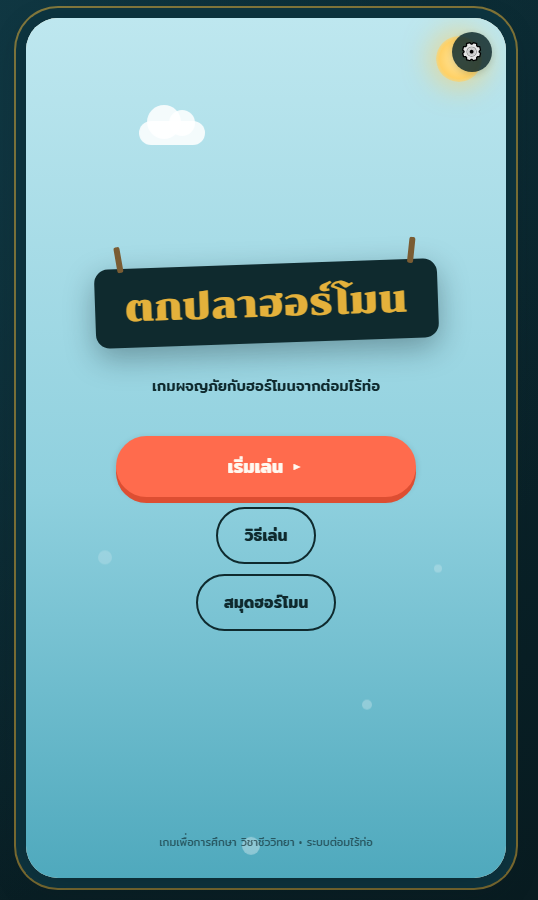
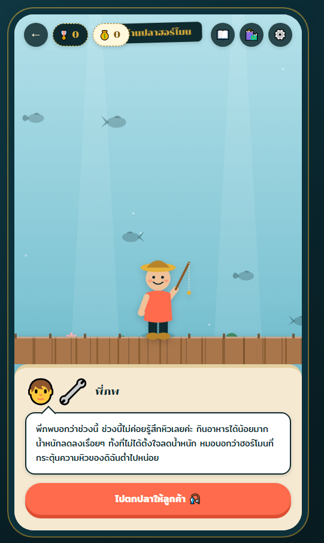
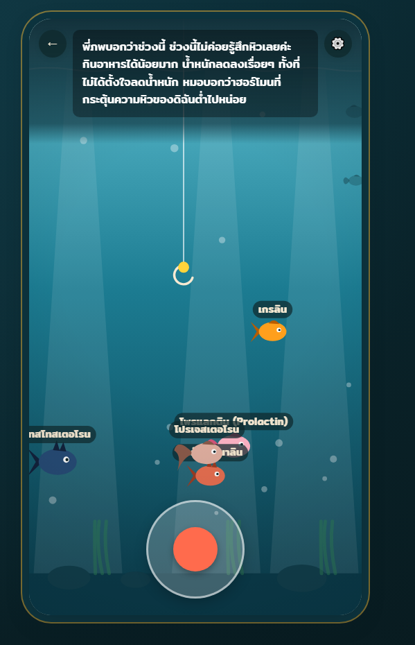
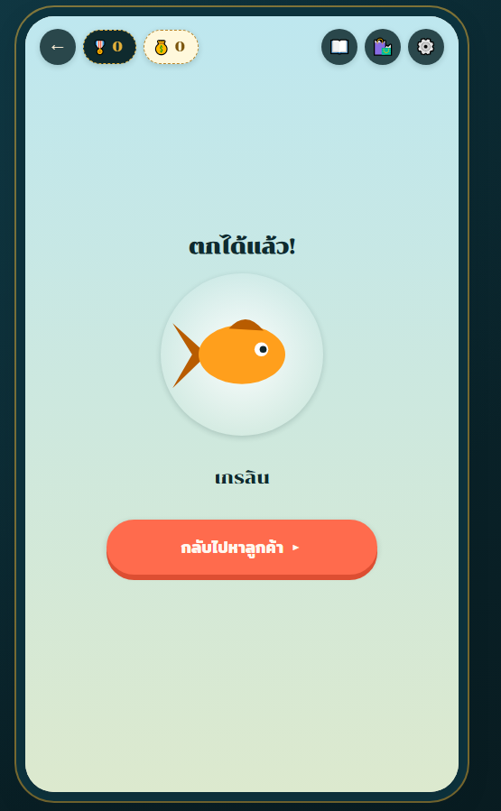
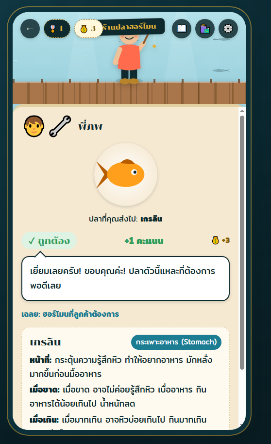
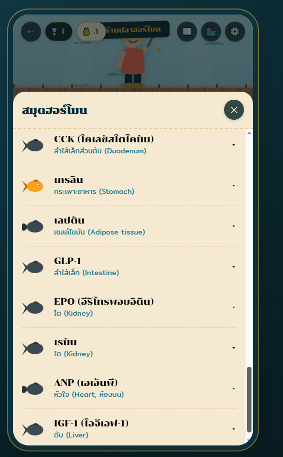

# 🎣 Hormone Fishing

An educational biology game about the **endocrine system and hormones**. Players take the role of a fisher who listens to a customer's symptoms, works out which hormone is needed, then catches the matching "hormone fish" and delivers it to the right person.

### ▶️ [Play the game](https://juicypapaya.github.io/Hormone-fishing/)

---

## Overview

Plays in any web browser on mobile or desktop. No installation or sign-up required. The game interface is in Thai.

## Learning Objectives

After playing, learners can:
- Identify the gland or organ that produces each hormone
- Describe the function of each hormone
- Link symptoms of hormone deficiency or excess to the hormone involved

## How to Play

1. Press **Start** and read the symptoms the customer describes.
2. Decide which hormone the symptoms point to, then head to the dock.
3. Move the character with the on-screen joystick (mobile) or keyboard (desktop) to get close to a fish.
4. Tap the button in time to reel the fish in.
5. Deliver the fish. The game shows whether it was correct, along with a summary of the hormone's function, deficiency and excess.

## Game Systems

| Feature | Details |
| --- | --- |
| Correct answer | +1 fame, +3 coins |
| Wrong answer | −1 fame, +1 coin |
| Next rounds | Fish move faster (up to 1.5x) |
| Hormone guide | Records details of every hormone you have caught |
| Shop | Spend coins on character outfits and fishing rods |

## Hormones Covered (35)

| Source | Hormones |
| --- | --- |
| Pancreas | Insulin, Glucagon, Somatostatin |
| Thyroid gland | Thyroxine, T3 |
| Parathyroid gland | PTH |
| Anterior pituitary | Growth hormone, Prolactin, TSH, ACTH, FSH, LH |
| Posterior pituitary / Hypothalamus | ADH, Oxytocin |
| Adrenal cortex | Cortisol, Aldosterone, DHEA |
| Adrenal medulla | Adrenaline, Noradrenaline |
| Pineal gland | Melatonin |
| Ovary / Placenta | Estrogen, Progesterone, Relaxin |
| Testis | Testosterone |
| Testis / Ovary | Inhibin |
| Stomach | Gastrin, Ghrelin |
| Small intestine | Secretin, CCK, GLP-1 |
| Adipose tissue | Leptin |
| Kidney | EPO, Renin |
| Heart | ANP |
| Liver | IGF-1 |

## Screenshots

| Title screen | Customer request | Fishing |
| --- | --- | --- |
|  |  |  |

| Caught a fish | Delivering the fish | Hormone book |
| --- | --- | --- |
|  |  |  |

## Built With

- HTML, CSS, JavaScript (single file, no external libraries)
- Canvas API for fish and scenery
- Web Audio API for sound effects
- Google Fonts: Chonburi, Mitr

## Run Locally

Download `index.html` and open it in any browser.

## Author

Q · [GitHub](https://github.com/JuicyPapaya)
